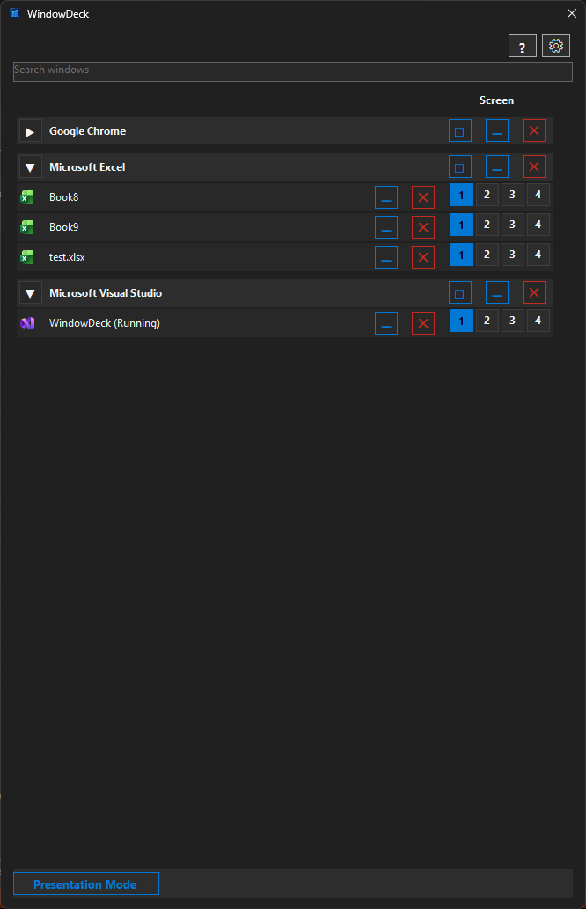
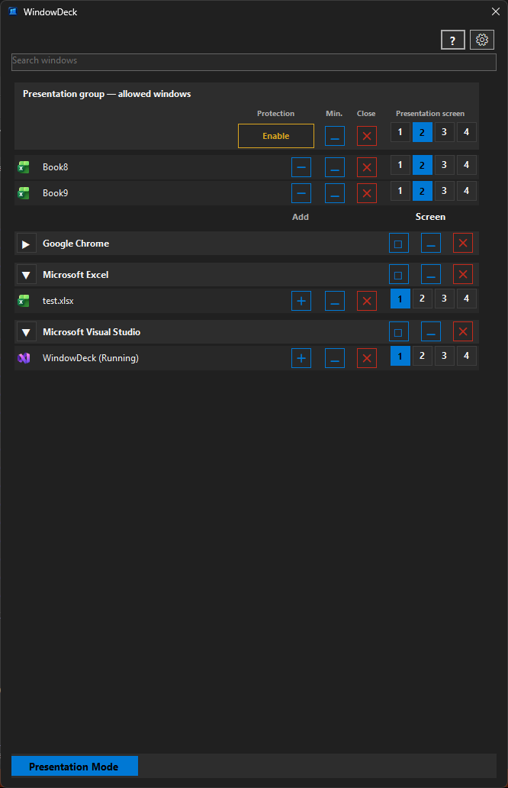
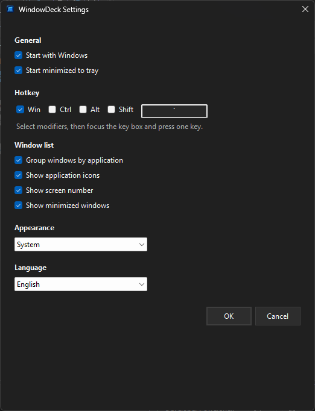
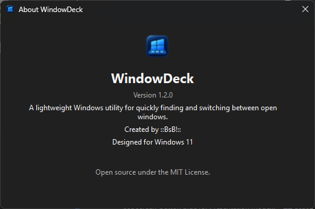

# WindowDeck

[**English**](#english) | [**Polski**](#polski)

---

## English

### Fast Window Switcher for Windows 11

**Find the exact open window you need in seconds.**

WindowDeck is a lightweight, event-driven **Windows 11 window switcher and open-window search utility** for people who work with many applications, documents, and monitors.

It gives you a searchable list of open windows, optional grouping by application, numbered monitor controls for moving windows between screens, and direct actions for the exact selected window — activate, minimize, or close.

WindowDeck is especially useful when many open windows have similar names or are spread across multiple screens.

> **About this project**
>
> I am not a software developer. WindowDeck started as a practical idea for solving a problem I had in everyday work.
>
> I designed the concept, requirements, workflow, and UI, and tested and refined the application iteratively. The code was created with the help of **ChatGPT** and **OpenAI Codex**.

### What's new in 1.4.0 — release candidate

**Version 1.4.0 is being prepared and has not been published yet.** The latest downloadable version remains available via the [GitHub Releases page](https://github.com/BsB92/WindowDeck/releases/latest).

- **Saved window sets:** name, save, update, reopen, and close selected collections of windows. Restore reliably identified documents and folders across work sessions; save multiple sets for different tasks or projects.
- **Safer set updates:** previously saved entries remain selected even when closed, with a floppy-disk indicator; newly found windows are unchecked until you explicitly add them.
- **Clearer Saved sets interface:** collapsible application groups, document names and file paths on separate lines, restore-status indicators, and shortcuts to copy full paths.
- **Better window-list refresh and ordering:** window changes are reflected more reliably without misplaced application groups; newly foregrounded windows no longer have to compete with WindowDeck's always-on-top panel.
- **Settings and presentation improvements:** an always-visible OK/Cancel footer, theme-matched dialog title bars, presentation setup dialogs displayed in front, and maintenance for historical WindowDeck notification-area icons.

[Read the 1.4.0 release-candidate notes](docs/notes/v1.4.0.md) · [1.4.0 validation checklist](docs/V1.4_FULL_VALIDATION.md).

### Previously in 1.3.0

Custom Screen numbering, consecutive default numbers, and auxiliary-window subgroups enabled by default. [1.3.0 release notes](docs/notes/v1.3.0.md).

### Screenshots

#### Main window

Search, group, switch, minimize, close, and move individual windows between monitors.



#### Presentation Mode

Presentation Mode lets you define an allowed group of windows for a selected presentation screen and optionally protect that screen from other windows.



#### Settings

Configure startup behavior, global hotkey, window list options, appearance, and language. In 1.4.0, the options scroll independently while OK and Cancel stay visible in the footer.



*The existing screenshots may show the earlier 1.3.x interface; updated 1.4.0 screenshots will be added after validation.*

#### About



### Download

Download the latest version from:

**[GitHub Releases](https://github.com/BsB92/WindowDeck/releases/latest)**

WindowDeck is distributed as a **single, self-contained `WindowDeck.exe`**.

No installer is required and no separate .NET Runtime installation is needed.

#### Windows SmartScreen

WindowDeck is currently distributed without a code-signing certificate.

Because of this, Windows SmartScreen may show an **"Unknown publisher"** warning when you run `WindowDeck.exe` for the first time.

This warning does not mean that Windows detected malware. It means the application is unsigned and does not yet have an established SmartScreen reputation.

If you downloaded WindowDeck from the official GitHub Releases page, you can verify the file source before running it.

#### Verify the download

Download `WindowDeck.exe.sha256` from the same release, or use the SHA-256 shown in that release's notes. Each checksum applies only to its matching executable.

You can verify the downloaded file in PowerShell:

```powershell
Get-FileHash .\WindowDeck.exe -Algorithm SHA256
```

The resulting hash should match the checksum from that same release.


### Features

- Quickly find and switch between open windows
- Search open windows by title
- Optional grouping by application
- Collapsible application groups
- Multiple named saved window sets, with save, reopen, update, and safe close actions (1.4.0)
- Grouped saved-set document preview with full-path tooltips, status indicators, and copy-path action (1.4.0)
- Non-destructive set updates that retain saved windows even when currently closed (1.4.0)
- Auxiliary dialogs and floating tools in collapsible subgroups (enabled by default)
- Custom Screen numbering remembered per connected-screen configuration
- Identify screens and reset numbering
- Presentation Mode with a protected presentation screen
- Cleaner window titles and friendlier application names
- Numbered monitor buttons for moving individual windows between screens
- Clear indication of the monitor currently containing each window
- Exact-window activation
- Minimize a specific window
- Send a normal close request to a specific window
- Restore all, Minimize all, and Close all actions for application groups
- Confirmation before closing all windows in a group
- Configurable global hotkey
- Opens on the screen containing the mouse cursor
- System tray integration
- Optional cleanup of obsolete WindowDeck tray-icon history records, with backup (1.4.0)
- Start with Windows
- Start minimized to tray
- Application icons
- Optional minimized-window display
- System / Light / Dark appearance
- Fixed Settings action footer and theme-matched saved-set dialog title bars (1.4.0)
- English and Polish interface
- Automatic language selection with the **System** option
- Built-in Help and About windows
- Single running application instance

WindowDeck uses event-driven window tracking and does not continuously poll for open windows.

### Quick start

1. Download `WindowDeck.exe` from the latest GitHub Release.
2. Run `WindowDeck.exe`.
3. WindowDeck starts in the **system tray**, so no main window may appear immediately.
4. Open WindowDeck by:
   - clicking the WindowDeck tray icon near the clock, or
   - using the default global shortcut **Win + `**
5. Search for a window or select one from the list.
6. Click a window to activate it.

The global shortcut can be changed in **Settings**.

WindowDeck continues running in the system tray when the panel is hidden.

To close WindowDeck completely, use:

**Tray icon → Exit**

### Window actions

Each WindowDeck row represents one specific Windows window.

- Click the window title to activate it.
- `—` minimizes that specific window.
- `×` sends a normal close request to that specific window.

WindowDeck does not force-kill applications.

If an application needs confirmation before closing, its normal **Save / Don't Save / Cancel** dialog remains in control.

Application groups can also be collapsed and expanded. Group headers provide **Restore all**, **Minimize all**, and **Close all** actions. Closing an entire group always requires confirmation.

### Multiple screens

With multiple monitors, WindowDeck shows numbered monitor buttons for each window. The current monitor is highlighted, and clicking another monitor number moves that exact window to the selected screen.

Normal, maximized, and minimized windows can be moved between monitors while preserving their appropriate window state.

When WindowDeck is opened using the global hotkey, it appears on the screen containing the mouse cursor.

### Custom Screen numbering

In **Settings > Screen numbering**, use **Identify screens** to see WindowDeck's numbers on each connected screen, then choose unique numbers 1–N. Assignments are saved per connected-screen configuration, so home and work setups can use different numbering. **Reset** restores consecutive default WindowDeck numbers. These numbers may differ from Windows Settings Identify; assign them manually if you want them to match. Sparse internal names such as DISPLAY5/6 are not used as visible Screen numbers.

### Auxiliary windows

Visible dialogs and floating tools with a title are included by default. In **Settings > Window list**, disable **Show auxiliary windows** to return to the main-window-only list. A previously saved disabled choice is preserved.

Confirmed same-process ownership creates a collapsible subgroup below the main window. Clicking the main title still activates that window; the arrow expands or collapses its auxiliary entries. Search temporarily reveals matching children with their owner. Windows without a confirmed visible owner remain separate entries. Embedded/docked panels and passive helpers are excluded. Individual actions and Presentation membership remain per window.

### Saved window sets (1.4.0)

Use **Saved sets** at the bottom of the main WindowDeck panel to manage named collections of open windows. You can keep a separate set for each quotation, customer, or project and reopen supported documents after restarting Windows.

1. Click **Saved sets → Save current**. All detected windows start checked; uncheck those you do not want to include, then name the set and save it.
2. Select a set and click **Open set**. WindowDeck attempts to reopen the exact saved files and File Explorer folders. A missing or moved file is reported by its saved path, while the remaining entries continue opening.
3. Click **Update set** to edit its name or contents. **Already saved entries stay checked**, even when their windows are closed, and display a small floppy-disk icon. New currently open windows are initially unchecked. Uncheck an old entry only if you intend to remove it; the change is not applied until you save.
4. Click **Close set** to request that currently open, unambiguously matched document and folder windows close. WindowDeck asks for confirmation, sends ordinary window-close requests, and leaves the saved set intact. Applications remain responsible for their own Save / Don't Save / Cancel prompts.

The Saved sets overview groups saved entries by application, with collapsible group headers, document titles, shortened paths, and readiness indicators. Hover over a path for its full location, or right-click to copy it.

**What can be restored?** File Explorer folders with real local paths and supported documents (including recognized Excel, Word, and PowerPoint files) can be reopened. For PDF or text editors, WindowDeck tries to identify the actual file automatically; when it cannot, **Choose file** lets you explicitly link the exact document. A green check means an entry is currently eligible for reopening, not that the app has already restored it; a red X identifies an unavailable or unresolved entry.

**Limits:** A browser or other entry marked **Program only** can start its application, but WindowDeck **does not restore the saved tabs or document state**. Such program-only entries are **excluded from Close set** to avoid closing unrelated tabs. A document whose path cannot be reliably determined may also be skipped. Saved sets do not preserve unsaved edits, tab sessions, exact monitor positions, or arbitrary application state. If an app contains multiple documents in one window, closing that window may affect other tabs; always check the confirmation. No process is force-killed.

Saved sets are stored locally in `%LocalAppData%\WindowDeck\window-sets.json`. This file is not removed when you replace the WindowDeck executable. See [the Saved sets help in the application](#quick-start) and the [1.4.0 validation checklist](docs/V1.4_FULL_VALIDATION.md).

### Settings maintenance (1.4.0)

Under **Settings → Maintenance**, you can review and manually clean up old Windows notification-area records for WindowDeck executables in other locations. WindowDeck makes a backup and preserves records for the running executable and other applications. This action is optional and never runs automatically.

### Languages

WindowDeck currently supports:

- **System**
- **English**
- **Polski**

With **System** selected:

- Polish Windows UI → Polish
- other Windows UI languages → English

The language can be changed in Settings without restarting WindowDeck.

### Appearance

Available appearance modes:

- **System**
- **Light**
- **Dark**

Language and appearance settings are independent.

### Privacy and network access

WindowDeck does not include:

- telemetry
- analytics
- user accounts
- cloud services
- automatic update checks
- automatic network communication

WindowDeck runs locally on your computer.

### System requirements

The published release is:

- designed for Windows 11
- Windows x64
- self-contained
- distributed as a single executable

A separate .NET Runtime installation is not required for the published release.

### Build from source

Requirements:

- .NET 10 SDK
- Windows desktop development workload
- Windows
- Visual Studio or the .NET CLI

Clone the repository and build:

```powershell
dotnet build WindowDeck.sln -c Release
```

You can also open `WindowDeck.sln` in Visual Studio and run the application with **F5**.

### Create a release build

The repository contains a publish profile for the Windows x64 release.

Run:

```powershell
powershell -NoProfile -ExecutionPolicy Bypass -File .\scripts\Prepare-Release.ps1
```

The output is created in:

```text
artifacts\WindowDeck-1.4.0-win-x64
```

The release configuration uses:

- Release configuration
- `win-x64`
- self-contained deployment
- single-file publishing
- trimming disabled
- NativeAOT disabled

The script also generates `WindowDeck.exe.sha256` and `RELEASE_NOTES.md` for the exact published executable. Manual publishing is still available with `dotnet publish WindowDeck.csproj -p:PublishProfile=WinX64`. Follow [the 1.4.0 release guide](docs/V1.4_RELEASE_GUIDE.md) and [the 1.4.0 validation checklist](docs/V1.4_FULL_VALIDATION.md).

### Project documentation

Detailed product behavior and technical requirements are documented in:

[`SPEC.md`](SPEC.md)

### License

WindowDeck is open source under the [MIT License](LICENSE).

Copyright (c) 2026 **::BsB!::**

---

## Polski

### Szybki przełącznik okien dla Windows 11

**Znajdź dokładnie to otwarte okno, którego potrzebujesz — w kilka sekund.**

WindowDeck to lekki, działający zdarzeniowo **przełącznik okien i narzędzie do wyszukiwania otwartych okien w Windows 11**, stworzone z myślą o osobach pracujących z wieloma aplikacjami, dokumentami i monitorami.

Program wyświetla przeszukiwalną listę otwartych okien, umożliwia opcjonalne grupowanie według aplikacji, pozwala przenosić okna między ekranami za pomocą numerowanych przycisków monitorów i wykonywać operacje bezpośrednio na wybranym oknie — aktywować je, zminimalizować lub zamknąć.

WindowDeck jest szczególnie przydatny, gdy wiele otwartych okien ma podobne nazwy albo jest rozmieszczonych na kilku ekranach.

> **O projekcie**
>
> Nie jestem programistą. WindowDeck powstał jako praktyczny pomysł na rozwiązanie problemu, z którym spotykałem się w codziennej pracy.
>
> Zaprojektowałem koncepcję, wymagania, sposób działania i interfejs użytkownika, a następnie iteracyjnie testowałem i dopracowywałem aplikację. Kod powstał przy wsparciu **ChatGPT** i **OpenAI Codex**.

### Co nowego w 1.4.0 — wersja przed wydaniem

**WindowDeck 1.4.0 jest przygotowywany do publikacji i nie został jeszcze wydany.** Aktualną wersję do pobrania znajdziesz na [stronie wydań GitHub](https://github.com/BsB92/WindowDeck/releases/latest).

- **Zapisane zestawy okien:** tworzenie wielu zestawów z własnymi nazwami, ich aktualizowanie, ponowne otwieranie i zamykanie dopasowanych okien. Przydatne np. do pracy nad kilkoma wycenami z różnymi skoroszytami.
- **Aktualizacja bez utraty pozycji:** wcześniej zapisane dokumenty pozostają zaznaczone nawet po zamknięciu; oznacza je dyskietka. Nowe okna dodajesz świadomie.
- **Czytelniejszy widok zestawów:** zwijane grupy aplikacji, oddzielne linie na nazwę dokumentu i ścieżkę, wskaźniki stanu oraz kopiowanie pełnej ścieżki.
- **Poprawki odświeżania i kolejności okien:** stabilniejsze grupowanie, aktualizowanie listy i wyświetlanie nowo otwartych okien przed panelem WindowDeck.
- **Ulepszone Ustawienia i tryb prezentacji:** stale widoczne przyciski OK/Anuluj, paski tytułu dopasowane do motywu, okna przygotowania prezentacji otwierane na wierzchu oraz czyszczenie starych wpisów ikon WindowDeck w zasobniku systemowym.

[Opis wersji 1.4.0](docs/notes/v1.4.0.md) · [Lista testów 1.4.0](docs/V1.4_FULL_VALIDATION.md).

### Wcześniej w 1.3.0

Własna numeracja ekranów, kolejne domyślne numery oraz domyślnie włączone podgrupy dodatkowych okien. [Opis wydania 1.3.0](docs/notes/v1.3.0.md).

### Zrzuty ekranu

#### Główne okno

Wyszukiwanie, grupowanie, przełączanie, minimalizowanie, zamykanie oraz przenoszenie pojedynczych okien między monitorami.


#### Tryb prezentacji

Tryb prezentacji pozwala określić grupę okien dozwolonych na wybranym ekranie prezentacji oraz opcjonalnie chronić ten ekran przed innymi oknami.


#### Ustawienia

Konfiguracja uruchamiania z systemem, globalnego skrótu, listy okien, wyglądu i języka. W wersji 1.4.0 przewija się tylko lista opcji, a przyciski OK i Anuluj pozostają widoczne na dole.


*Dotychczasowe zrzuty ekranu mogą przedstawiać interfejs wersji 1.3.x; zrzuty 1.4.0 dodamy po zakończeniu testów.*

#### O programie


### Pobieranie

Najnowszą wersję można pobrać tutaj:

**[GitHub Releases](https://github.com/BsB92/WindowDeck/releases/latest)**

WindowDeck jest udostępniany jako **pojedynczy, samodzielny plik `WindowDeck.exe`**.

Instalator nie jest wymagany. Nie trzeba też osobno instalować środowiska .NET Runtime.

#### Windows SmartScreen

WindowDeck jest obecnie udostępniany bez certyfikatu podpisu kodu.

Z tego powodu Windows SmartScreen może przy pierwszym uruchomieniu `WindowDeck.exe` wyświetlić ostrzeżenie **„Nieznany wydawca”**.

Takie ostrzeżenie nie oznacza, że Windows wykrył złośliwe oprogramowanie. Oznacza jedynie, że aplikacja nie jest podpisana cyfrowo i nie ma jeszcze wyrobionej reputacji w SmartScreen.

Jeżeli pobrałeś WindowDeck z oficjalnej strony GitHub Releases, przed uruchomieniem możesz zweryfikować pochodzenie pliku.

#### Weryfikacja pobranego pliku

Pobierz `WindowDeck.exe.sha256` z tego samego wydania lub odczytaj SHA-256 z jego opisu. Każdy skrót dotyczy wyłącznie odpowiadającego mu pliku wykonywalnego.

Pobrany plik możesz sprawdzić w PowerShell:

```powershell
Get-FileHash .\WindowDeck.exe -Algorithm SHA256
```

Otrzymany skrót powinien być identyczny z wartością z tego samego wydania.

### Funkcje

- Szybkie wyszukiwanie i przełączanie między otwartymi oknami
- Wyszukiwanie otwartych okien po tytule
- Opcjonalne grupowanie według aplikacji
- Zwijanie i rozwijanie grup aplikacji
- Wiele nazwanych zestawów okien — zapisywanie, ponowne otwieranie, aktualizacja i bezpieczne zamykanie (1.4.0)
- Podgląd zestawów pogrupowany według aplikacji, ze ścieżkami, wskaźnikami stanu i kopiowaniem lokalizacji pliku (1.4.0)
- Aktualizacja zestawów bez automatycznego usuwania zapisanych, ale obecnie zamkniętych okien (1.4.0)
- Dodatkowe dialogi i pływające narzędzia w zwijanych podgrupach (domyślnie włączone)
- Własna numeracja ekranów zapamiętywana dla zestawu podłączonych ekranów
- Identyfikacja ekranów i resetowanie numeracji
- Tryb prezentacji z ochroną ekranu prezentacyjnego
- Czytelniejsze tytuły okien i przyjaźniejsze nazwy aplikacji
- Numerowane przyciski monitorów do przenoszenia pojedynczych okien między ekranami
- Wyraźne oznaczenie monitora, na którym aktualnie znajduje się okno
- Aktywacja dokładnie wybranego okna
- Minimalizowanie konkretnego okna
- Wysyłanie standardowego żądania zamknięcia do konkretnego okna
- Akcje Przywróć wszystkie, Minimalizuj wszystkie i Zamknij wszystkie dla grup aplikacji
- Potwierdzenie przed zamknięciem wszystkich okien w grupie
- Konfigurowalny globalny skrót klawiaturowy
- Otwieranie na ekranie, na którym znajduje się kursor myszy
- Integracja z zasobnikiem systemowym
- Opcjonalne usuwanie starych wpisów ikon WindowDeck w zasobniku, z wykonaniem kopii zapasowej (1.4.0)
- Uruchamianie razem z systemem Windows
- Uruchamianie zminimalizowane do zasobnika systemowego
- Ikony aplikacji
- Opcjonalne wyświetlanie zminimalizowanych okien
- Tryby wyglądu System / Jasny / Ciemny
- Stały pasek przycisków w Ustawieniach i paski tytułu okien zestawów dopasowane do motywu (1.4.0)
- Interfejs w języku angielskim i polskim
- Automatyczny wybór języka przy ustawieniu **System**
- Wbudowane okna Pomoc i O programie
- Tylko jedna uruchomiona instancja aplikacji

WindowDeck śledzi okna w sposób zdarzeniowy i nie odpytuje systemu w sposób ciągły.

### Szybki start

1. Pobierz `WindowDeck.exe` z najnowszego wydania na GitHubie.
2. Uruchom `WindowDeck.exe`.
3. WindowDeck uruchamia się w **zasobniku systemowym**, dlatego główne okno może nie pojawić się od razu.
4. Otwórz WindowDeck:
   - klikając ikonę WindowDeck w zasobniku systemowym obok zegara albo
   - używając domyślnego globalnego skrótu **Win + `**
5. Wyszukaj okno lub wybierz je z listy.
6. Kliknij okno, aby je aktywować.

Globalny skrót można zmienić w **Ustawieniach**.

Po ukryciu panelu WindowDeck nadal działa w zasobniku systemowym.

Aby całkowicie zamknąć WindowDeck, użyj:

**Ikona w zasobniku → Zakończ**

### Operacje na oknach

Każdy wiersz w WindowDeck odpowiada jednemu konkretnemu oknu systemu Windows.

- Kliknięcie tytułu aktywuje dane okno.
- `—` minimalizuje dane okno.
- `×` wysyła standardowe żądanie zamknięcia do danego okna.

WindowDeck nie wymusza zakończenia procesu aplikacji.

Jeżeli aplikacja wymaga potwierdzenia przed zamknięciem, jej standardowe okno **Zapisz / Nie zapisuj / Anuluj** nadal działa normalnie.

Grupy aplikacji można również zwijać i rozwijać. Nagłówek grupy udostępnia akcje **Przywróć wszystkie**, **Minimalizuj wszystkie** i **Zamknij wszystkie**. Zamknięcie całej grupy zawsze wymaga potwierdzenia.

### Wiele ekranów

Przy wielu monitorach WindowDeck pokazuje przy każdym oknie numerowane przyciski monitorów. Aktualny monitor jest wyróżniony, a kliknięcie innego numeru przenosi dokładnie to okno na wybrany ekran.

Między monitorami można przenosić okna zwykłe, zmaksymalizowane i zminimalizowane z zachowaniem odpowiedniego stanu okna.

Po otwarciu WindowDeck globalnym skrótem program pojawia się na ekranie, na którym znajduje się kursor myszy.

### Własna numeracja ekranów

W **Ustawieniach > Numeracja ekranów** użyj **Identyfikuj ekrany**, aby zobaczyć numery WindowDeck na każdym ekranie, a następnie przypisz unikalne numery 1–N. Wybór jest zapamiętywany dla zestawu podłączonych ekranów, więc konfiguracja w domu i pracy może być inna. **Resetuj** przywraca kolejne domyślne numery WindowDeck. Mogą one różnić się od numerów funkcji Identyfikuj w ustawieniach Windows; zgodność można uzyskać przez ręczne przypisanie. Wewnętrzne nazwy typu DISPLAY5/6 nie są wyświetlane jako numery ekranów.

### Dodatkowe okna

Widoczne dialogi i pływające narzędzia z tytułem są domyślnie uwzględniane. W **Ustawieniach > Lista okien** wyłącz **Pokaż dodatkowe okna**, aby wrócić do listy głównych okien. Wcześniej zapisane wyłączenie pozostaje respektowane.

Potwierdzone powiązanie właściciela w tym samym procesie tworzy zwijaną podgrupę pod głównym oknem. Kliknięcie tytułu nadal aktywuje główne okno, a strzałka rozwija lub zwija dodatkowe wpisy. Wyszukiwanie tymczasowo pokazuje pasujące okna razem z właścicielem. Okna bez potwierdzonego widocznego właściciela pozostają osobnymi wpisami. Panele osadzone lub zadokowane i pasywne okna pomocnicze są pomijane. Akcje i przynależność do grupy prezentacyjnej dotyczą pojedynczych okien.

### Zapisane zestawy okien (1.4.0)

Przycisk **Zestawy okien** na dole głównego panelu WindowDeck pozwala przechowywać nazwane zestawy otwartych okien. Możesz mieć osobny zestaw dla każdej wyceny, klienta lub projektu, a następnego dnia ponownie otworzyć rozpoznane dokumenty.

1. Wybierz **Zestawy okien → Zapisz obecne**. Początkowo wszystkie wykryte okna są zaznaczone. Odznacz niepotrzebne pozycje, wpisz nazwę zestawu i zapisz.
2. Wybierz zestaw i kliknij **Otwórz zestaw**. WindowDeck próbuje uruchomić dokładnie zapisane pliki i foldery Eksploratora. Jeżeli pliku brakuje lub został przeniesiony, program pokazuje jego zapisaną ścieżkę, ale nadal próbuje otworzyć pozostałe pozycje.
3. Kliknij **Aktualizuj zestaw**, aby zmienić nazwę lub zawartość. **Wcześniej zapisane pozycje pozostają zaznaczone**, nawet jeśli są obecnie zamknięte, i mają ikonę dyskietki. Nowe okna są początkowo odznaczone. Odznaczenie zapisanej pozycji oznacza zamiar jej usunięcia, ale zmiana następuje dopiero po zapisaniu aktualizacji.
4. Kliknij **Zamknij zestaw**, aby wysłać standardowe polecenia zamknięcia do otwartych okien, które da się jednoznacznie powiązać z zapisanymi dokumentami lub folderami. WindowDeck prosi o potwierdzenie, a sam zestaw pozostaje zachowany. O zapisaniu niezapisanych zmian decyduje aplikacja, np. Excel przez własne okno **Zapisz / Nie zapisuj / Anuluj**.

Podgląd zestawu grupuje pozycje według aplikacji. Grupy można zwijać; każda pozycja ma nazwę okna, skróconą ścieżkę i wskaźnik stanu. Pełną ścieżkę zobaczysz po najechaniu myszą albo skopiujesz prawym przyciskiem.

**Co można przywrócić?** Rzeczywiste foldery Eksploratora oraz obsługiwane dokumenty, m.in. rozpoznane pliki Excel, Word i PowerPoint. Dla czytników PDF i edytorów tekstu WindowDeck próbuje automatycznie ustalić konkretny plik. Jeżeli nie jest to możliwe, przycisk **Wskaż plik** pozwala przypisać dokument ręcznie. Zielony haczyk oznacza gotowość pozycji do ponownego otwarcia, a nie potwierdzenie, że plik został już uruchomiony. Czerwony X informuje o brakującej lub nierozpoznanej lokalizacji.

**Ograniczenia:** Pozycje **Tylko program**, np. przeglądarki, mogą uruchomić aplikację, ale WindowDeck **nie przywraca zapisanych kart ani ich stanu**. Takie pozycje są **pomijane przez Zamknij zestaw**, aby nie zamknąć niepowiązanych kart. Pomijane mogą być również dokumenty bez wiarygodnej ścieżki. Zestawy nie odtwarzają niezapisanych zmian, sesji kart, dokładnego rozmieszczenia okien na monitorach ani całego stanu aplikacji. Jeśli kilka kart należy do jednego okna, zamknięcie go może objąć także inne karty. WindowDeck nie wymusza kończenia procesów.

Dane zestawów znajdują się lokalnie w pliku `%LocalAppData%\WindowDeck\window-sets.json`. Podmiana pliku wykonywalnego WindowDeck nie usuwa zestawów. Więcej szczegółów znajdziesz w pomocy programu i na [liście testów 1.4.0](docs/V1.4_FULL_VALIDATION.md).

### Konserwacja ikon (1.4.0)

W **Ustawienia → Konserwacja** możesz sprawdzić i ręcznie usunąć stare wpisy ikon WindowDeck w zasobniku systemowym, pochodzące z innych lokalizacji pliku wykonywalnego. Program tworzy kopię zapasową oraz zachowuje wpisy bieżącego WindowDeck i pozostałych aplikacji. Funkcja jest opcjonalna i nigdy nie działa automatycznie.

### Języki

WindowDeck obsługuje obecnie:

- **System**
- **English**
- **Polski**

Przy wybranym ustawieniu **System**:

- polski interfejs Windows → Polski
- pozostałe języki interfejsu Windows → English

Język można zmienić w Ustawieniach bez ponownego uruchamiania WindowDeck.

### Wygląd

Dostępne tryby wyglądu:

- **System**
- **Jasny**
- **Ciemny**

Ustawienia języka i wyglądu są od siebie niezależne.

### Prywatność i dostęp do sieci

WindowDeck nie zawiera:

- telemetrii
- analityki
- kont użytkowników
- usług chmurowych
- automatycznego sprawdzania aktualizacji
- automatycznej komunikacji sieciowej

WindowDeck działa lokalnie na komputerze użytkownika.

### Wymagania systemowe

Opublikowana wersja jest:

- przeznaczona dla Windows 11
- przygotowana dla Windows x64
- samodzielna
- udostępniana jako pojedynczy plik wykonywalny

Dla opublikowanej wersji nie jest wymagana osobna instalacja .NET Runtime.

### Kompilowanie ze źródeł

Wymagania:

- .NET 10 SDK
- pakiet narzędzi do tworzenia aplikacji desktopowych dla Windows
- Windows
- Visual Studio lub .NET CLI

Sklonuj repozytorium i uruchom kompilację:

```powershell
dotnet build WindowDeck.sln -c Release
```

Możesz również otworzyć `WindowDeck.sln` w Visual Studio i uruchomić aplikację klawiszem **F5**.

### Tworzenie wersji wydaniowej

Repozytorium zawiera profil publikowania dla Windows x64.

Uruchom:

```powershell
powershell -NoProfile -ExecutionPolicy Bypass -File .\scripts\Prepare-Release.ps1
```

Pliki wynikowe są tworzone w:

```text
artifacts\WindowDeck-1.3.0-win-x64
```

Konfiguracja wydania wykorzystuje:

- konfigurację Release
- `win-x64`
- samodzielne wdrożenie
- publikowanie jako pojedynczy plik
- wyłączone przycinanie kodu
- wyłączone NativeAOT

Skrypt tworzy również `WindowDeck.exe.sha256` i `RELEASE_NOTES.md` dla dokładnie tego pliku EXE. Nadal można użyć `dotnet publish WindowDeck.csproj -p:PublishProfile=WinX64`. Kolejność publikacji opisuje [instrukcja wydania 1.4.0](docs/V1.4_RELEASE_GUIDE.md), a testy [lista kontrolna 1.4.0](docs/V1.4_FULL_VALIDATION.md).

### Dokumentacja projektu

Szczegółowe zachowanie produktu i wymagania techniczne są opisane w:

[`SPEC.md`](SPEC.md)

### Licencja

WindowDeck jest projektem open source udostępnianym na licencji [MIT](LICENSE).

Copyright (c) 2026 **::BsB!::**
